# Milestone 5: persistent personal monitoring

Status: implementation verified offline. M4.3 live success does not certify M5 automatic delivery.
Architecture and Devil's Advocate decisions: [technical plan](superpowers/plans/2026-10-12-milestone-5.md).

## Flow and guarantees

```mermaid
flowchart LR
  Owner["Private owner /monitor on"] --> Cursor["First activation: history baseline only"]
  Cursor --> History["Later pass: bounded messageAdded history"]
  History --> Ledger["Skip processed message IDs"]
  Ledger --> Gate["Scopes/account + exact Subject/From + activation date"]
  Gate --> Parser["Body → MIME → KWORK_TABLE_POLICY"]
  Parser --> Rules["match / review / exclude"]
  Rules --> Reserve["SQLite: message outcome + unique project reservation"]
  Reserve --> Send["match only: validated private notifier"]
  Send --> Result["sent or delivery_unknown; never auto resend"]
```

SQLite is built into supported Node.js 24; no PostgreSQL, ORM or new dependency.
The installed Node 24.1 reports its SQLite API as experimental. WAL and synchronous=FULL
protect short transactions; SQL parameters and unique keys protect identities.
Only one local process may own the database. A stored host/PID session is acquired
in a transaction; a live/uncertain PID or another host fails closed. Dead processes
permit recovery. PID reuse can conservatively block startup; no unsafe automatic unlock.
Use local disk, one checkout/process, not a network share or shared multi-host volume.

An independent `monitor.sqlite.guard.json` stores an epoch and monotonic revision only.
Every ledger transaction commits SQL then atomically replaces the fsynced guard, before
returning permission to send. A missing DB with a retained guard, a missing guard with
an existing DB, a different epoch, or a DB older than its guard fails closed. A DB ahead
of its guard after a process crash is recoverable; orphan reservations remain unknown.
Failure to update the guard after SQL commit pauses before any new send. A crash during
first initialization can require manual repair instead of silently recreating state.
Deleting/restoring the WHOLE directory including its guard, a changed path, OS-level
power loss and dishonest/inconsistent backups cannot be fully detected with local state.
Preserve the independent current guard when restoring a DB; do not roll it back to make
an old backup open. This protection is not a substitute for consistent backups.

DB contains private message/project IDs, classifier codes, outcomes, cursor, activation
floor and a hashed account/owner binding. No mail payload, title, description, account
address or OAuth secret is persisted. Default path is `.local-state/monitor.sqlite`,
ignored with WAL/SHM. Never copy databases/artifacts into published fixtures.

## Crash, delivery and privacy policy

- `filtered`: review/exclude, no send; first observed classification is retained.
- `reserved`: transaction committed before any send; processed message and all its
  project states are committed together.
- `sent`: Telegram API returned success.
- `delivery_unknown`: error/rejection/timeout, interruption before a reserved send,
  or orphan reservation recovered after restart. All are terminal, no automatic retry.

The existing notifier deliberately hides API exceptions, so even a definite rejection
is conservatively treated as unknown. This favors no duplicates over completeness.
Crash between reservation and send, or accepted send before result persistence, can
lose a notification. This is at-most-one application send attempt with an intact ledger,
not exactly-once delivery and not a guarantee about SDK transport attempts (F2).
Do not delete/roll back state or retry unknown delivery casually. An older backup,
lost DB plus its guard, changed path or separate independent DB invalidates the dedup guarantee.
State begins with M5; prior standalone M4.3 sends are not imported as project tombstones.

Messages have separate outcomes: parsed, parse_failed, rejected, historical, retry,
read_failed. MIME/parser ambiguity (except harmless invalid_optional/duplicate_project)
rejects the whole message, persists parse_failed and never automatically rereads it.
Transient metadata/body failures keep cursor unchanged and get at most three attempts
on separate scheduled/manual passes; after three they become read_failed. There is
no immediate application retry. Known access/auth failures at metadata/full stages pause
immediately without consuming the transient retry budget. There is no independent retry
queue: the unchanged cursor retains retryable events. Expired history requires an explicit
decision to skip backlog; a retry cannot be recovered automatically after such a reset.
Logs and command summaries contain fixed codes/counts,
no message IDs, headers, URLs, content or raw errors. Project card content remains
the expressly authorized destination payload.

## Discovery and limits

`findKworkEmails` still serves the standalone bounded metadata checker and isolated
legacy M4.2 tests. Its newest five sampled results are never used as M5 completeness proof.
Monitoring verifies readonly scopes/account once per pass, captures the current upper
historyId, then enumerates `messageAdded` records from the durable cursor through that
upper bound. History IDs are strings/BigInt, not JS timestamp/Number cursors. Equal
internalDate values and late additions with dates after activation are retained.
Later history records stay for the next pass. Only a complete pass advances cursor.

First activation captures local activation time BEFORE asynchronous history capture and
stores that floor with current historyId; no history/body
request or card. Pre-existing mail is excluded. Backdated/imported messages older
than activation are metadata-only rejected; this deliberately excludes delayed
preactivation mail too. History is finite: Gmail 404 means pause, no automatic full
sync. `/monitor baseline` while off initializes a new cursor only. Repeating it returns
`baseline_exists` without Gmail or state replacement. Only explicit private-owner
`/monitor baseline confirm` while off replaces cursor/floor, intentionally skipping backlog
without clearing dedup tombstones. Initialization/pass/baseline share one active operation.

Limits per pass: 10 history pages × 100 records; at most 100 distinct added message IDs
(including non-Kwork additions), 200 parsed projects and 10 card attempts.
`MONITOR_MAX_MESSAGES` (1..100) and `MONITOR_MAX_SENDS` (1..10) can reduce the limits.
Overflow or malformed/cyclic pagination pauses before bodies, keeps cursor. A message
with more match projects than the send cap pauses without reservation; incomplete
processing otherwise keeps cursor and ledger lets later passes resume without duplicates.
OAuth/profile/cursor plus pages and metadata/full give at most 214 Gmail/OAuth application-level
calls and 10 card attempts per full default pass (224 total, excluding Telegram control replies and SDK retries).
Gmail request timeout is 10 seconds; Telegram client timeout is 45 seconds.

New message transactions stop once the ledger reaches 100,000 message/project rows;
a final project batch can cross that threshold by at most the parser's 100-row limit.
SQLite also has a page cap (approximately 64 MiB at default 4 KiB page size).
Tombstones are not evicted; exhaustion needs manual
maintenance, no silent restart with an empty ledger. A changed account/owner requires
an explicit separate state policy; the existing binding refuses silent reuse.

## Filtering

Rules live in `src/filters/rules.ts`, classifier in `projectFilter.ts`. Match needs a
supported primary technology and a task/action signal. Python/Telegram auxiliary work
also needs a small-scope signal. CMS-only or explicit unrelated tasks are exclude;
mixed technology, complex scope, missing evidence and customer/budget cautions are review.
Only match cards send automatically. Review/exclude are counted/stored, no card.
No Kwork interactions, paid services, callbacks, LLM or customer replies.

Negated, quoted, unrelated/historical stack mentions conservatively produce review;
fullstack/large platform signals also produce review. These rules still have false positives
(novel phrasing can conceal scope or irrelevance) and false negatives (abbreviations, unlabeled stack and category-only
text). They do not measure complexity, price fairness or customer quality. Optional
price, hireRate and explicitly labelled exchangeProjects can add caution; no missing
values are invented. Filtered projects are not automatically reclassified on later
copies or rule edits. Review only stores project identity/reasons, not text for a review UI.
Business tradeoff: good but ambiguous review projects do not arrive as cards. The owner
can see aggregate `counts.review` and `counts.exclude` in status; M5 has no review inbox.

## Commands and restart

- `/monitor on`: true private owner context, fresh memory opt-in, one immediate pass.
  On a new DB that is baseline only; on restart it resumes existing backlog/cursor.
- `/monitor off`: blocks further operations, clears timer, awaits active operation.
- `/monitor status`: no Gmail. `storageOpen=false` means durable counts were not loaded
  in this process yet; zero counts in that state do not describe existing disk data.
  Shows enabled/running, lastCompletedAt (last settled attempt, including errors),
  nextAttemptAt, lastErrorCategory, blocked and durable message/project state counts,
  including review/exclude. Times are Unix milliseconds or null. Blocked persists after
  off or baseline_exists until successful recovery; history_expired requires a decision.
- `/projects`: the same pass, only while enabled; no legacy bypass.
- `/monitor baseline`: only while off, true private context, metadata-only initialization.
- `/monitor baseline confirm`: only while off, explicit acceptance of skipped backlog.

`MONITOR_INTERVAL_MINUTES` defaults to 360 (six hours), accepted range 5..1440. A recursive
timeout is armed after each settled operation; slow passes never overlap manual/timer.
Temporary Gmail failure waits the full interval, terminal discovery/storage problems
pause. Known OAuth/account/permission failures pause as `gmail_access_error` until
configuration is corrected and the owner explicitly reactivates monitoring.
Process restart always begins off; `/start` alone does not activate it.
Startup drops queued Telegram updates, including old /monitor on; send commands only
after readiness. This also discards other pending bot updates.

Off/SIGINT/SIGTERM drain current network operation. A send already started can finish;
its status is persisted before closing storage. No later body/send starts. Shutdown
before polling readiness is remembered. No background service is installed: the local
Node process must remain running; deployment/restart supervision is outside M5.

Long operations run outside the polling handler so queued /monitor off can be processed
during a manual/on pass. Command replies immediately show controller status; completion
results go to the local console, and /monitor status shows the final fixed status/counters.

Off first shows enabled=false/running=true while draining; its command reply is sent only
after draining completes. A previously started card may finish during that wait, never
after the off command completes. SQLite commits are synchronous; shutdown cannot interrupt
a JS transaction midway and waits for the pass before closing the connection.

## Manual recovery boundaries

For history_expired/overflow, stop monitoring and inspect only safe status. Decide whether
to preserve backlog for investigation or knowingly skip it using `/monitor baseline confirm`.
No automatic full sync or reset. Project tombstones remain authoritative after reset.

For storage_busy, stop all project-monitor processes and verify the recorded process is
dead using local process tools, without dumping credential-bearing command lines. Dead
same-host PID recovery is automatic; foreign host, uncertain PID or PID reuse stays blocked.
Do not delete the database or guard. A targeted session-row repair is a separate authorized
maintenance operation, after independent proof there is no active monitor process.
Corruption/schema/guard mismatch requires a consistent backup investigation, not retry
with a fresh DB. Restoring old state can invalidate dedup; retain the guard and treat refusal
as protection. An unpublished earlier M5 database without guard is refused, not migrated.

`parse_failed`/`read_failed` and filtered projects are terminal. M5 deliberately provides no
automatic replay command. Selective recovery is a separate follow-up: owner authorizes ONE
local selected failed message, all monitor instances are stopped, state is backed up,
repaired parser is proven offline, then a dedicated gated one-read recovery path would
operate on that ID while retaining EVERY project tombstone. Deleting the whole ledger,
bulk changing message outcomes or resetting history to force rereads is unsafe. The current
acceptance harness refuses terminal messages and is not such a recovery tool.

Node 24.1.0 is the tested runtime; `node:sqlite` is experimental and synchronous. Short
transactions and a 1-second busy timeout can briefly block command handling. No native
addon, ORM or new dependency was introduced. Upgrading Node remains a separately checked
maintenance action; no claim that all future experimental API versions are compatible.

## Separate live acceptance plan — not executed

1. Owner authorizes M5 explicitly: metadata history/profile, at most one new Kwork
   message body and one card attempt; existing scopes/account/F3 gates remain mandatory.
2. Separate preparation authorization: if no baseline exists, start production with
   monitoring OFF and use only genuine private-owner `/monitor baseline`, then wait for
   initialized/running=false and stop that bot. Control replies in this metadata-only
   preparation are separate from the one-card acceptance run. Existing baseline is
   preserved; replacement needs explicit `/monitor baseline confirm` and acceptance of
   skipped backlog. Never `/monitor on` or `/projects` for one-card acceptance.
3. With separately authorized metadata-only selection, choose exactly ONE new message
   added AFTER baseline. Save only `MONITOR_ACCEPTANCE_MESSAGE_ID` in Git-ignored
   `.local-acceptance/monitor-acceptance.env`, without printing it. Old M4.3 selection
   does not qualify. Do not delete state to make a previously sent project eligible.
4. Stop every production/smoke instance, retain DB/guard/WAL/SHM. From repo root in
   ordinary Windows PowerShell, clear any stale process override without showing it:
   `Remove-Item Env:MONITOR_ACCEPTANCE_MESSAGE_ID -ErrorAction SilentlyContinue`.
   Then, only after separate live authorization, run:

   `node --env-file-if-exists=.env --env-file=.local-acceptance/monitor-acceptance.env --import tsx src/monitor/acceptanceRun.ts`

5. Wait for `Acceptance ready`, send ONE `/acceptance` in owner private chat. No other
   command can start the pass. Pending updates are dropped. A 10-minute wait limit
   stops polling; there is no scheduler and no technical Telegram reply.
6. The entire run is synchronously reserved before the first await. All bounded history
   pages are collected before reader work; more than one distinct fenced added message
   aborts (including unrelated mail), absent/wrong selected ID aborts, multiple parsed
   projects abort. At most one selected reader invocation (and one application full-body
   request after scopes/account/metadata/floor gates) and one card attempt are possible
   for the WHOLE process run, including concurrent/repeated commands and failures.
   Global ledger reservations/dedup remain mandatory. Even a read failure consumes the
   run; it cannot trigger a retry. New events beyond the upper fence remain for a future
   separately authorized monitoring pass and are never read by this acceptance run.
7. The harness logs fixed counts/status and stops after its sole attempt. Inspect actual
   card/button if sent. Zero cards, overflow, mismatch, parse/filter failure or unknown
   delivery ends acceptance; never automatically restart it. Restarting the command is
   a NEW live run and requires NEW owner authorization. This is an application budget,
   not a guarantee about Google SDK transport retries. Only after acceptance separately
   authorize production scheduler/live operation. No real requests were run in this review.
